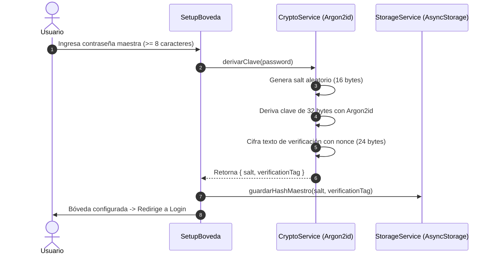
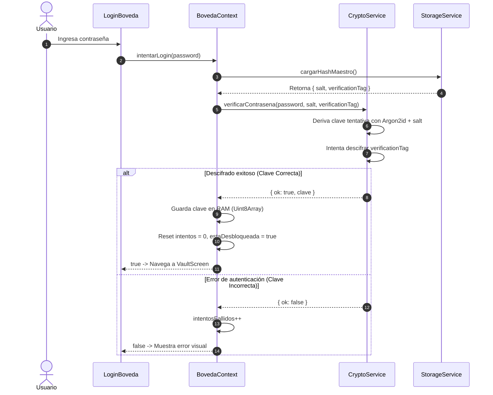
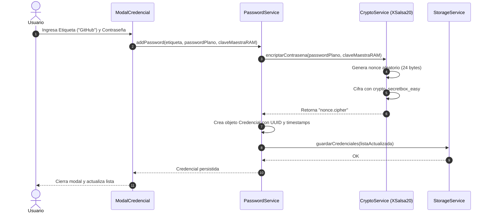
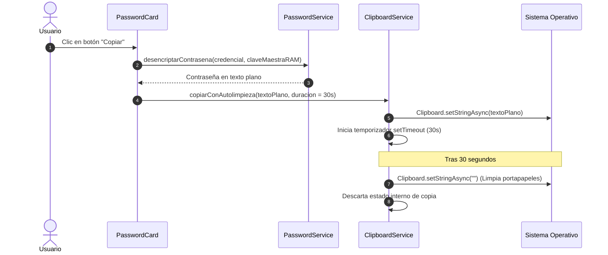

# Arquitectura de Passnager

Este documento describe la arquitectura de software, los patrones de diseño y los diagramas de flujo de **Passnager**.

---

## Principios de Diseño

1. **Local-First & Offline**: La aplicación no depende de ninguna conexión a internet, servidor externo o backend. Toda la base de datos reside localmente en el dispositivo.
2. **Zero-Knowledge Architecture**: La aplicación nunca almacena ni conoce la contraseña maestra del usuario. Solo se almacena el material criptográfico necesario para validar el descifrado autenticado.
3. **Separación de Responsabilidades (SoC)**: La interfaz de usuario (pantallas y componentes) no ejecuta operaciones criptográficas directas; delega todas las tareas de datos en capas de servicio dedicadas.
4. **Mínimo Privilegio de Memoria**: La clave derivada de 32 bytes solo reside en memoria RAM durante la sesión activa y se borra inmediatamente al cerrar sesión.

---

## Estructura de Carpetas

```text
Passnager/
├── .github/
│   └── workflows/
│       └── ci.yml               # Pipeline de integración continua (Lint, Typecheck, Tests)
├── assets/                      # Iconos, splash screens e imágenes estáticas
├── patches/                     # Parches locales aplicados mediante patch-package
├── src/
│   ├── components/              # Componentes de presentación y modales reutilizables
│   │   ├── CustomAlert.tsx      # Modal de confirmación y advertencias personalizadas
│   │   ├── ModalCredencial.tsx  # Bottom-sheet para agregar y editar credenciales
│   │   └── PasswordCard.tsx     # Tarjeta de credencial individual (copiar, revelar, editar, eliminar)
│   ├── constants/
│   │   └── colors.js            # Tokens de diseño y paleta de colores Dark Mode
│   ├── context/
│   │   └── BovedaContext.tsx    # Contexto global para la sesión en memoria (RAM)
│   ├── screens/                 # Vistas y pantallas principales de navegación
│   │   ├── SplashScreen.tsx     # Pantalla de carga y decisión de ruta inicial
│   │   ├── SetupBoveda.tsx      # Flujo de bienvenida y creación de contraseña maestra
│   │   ├── LoginBoveda.tsx      # Autenticación y desbloqueo de la bóveda
│   │   └── VaultScreen.tsx      # Pantalla principal con lista y buscador de credenciales
│   ├── services/                # Capa de servicios y lógica pura desacoplada
│   │   ├── __tests__/           # Pruebas unitarias automatizadas con Jest
│   │   │   ├── cryptoService.test.ts
│   │   │   └── passwordService.test.ts
│   │   ├── clipboardService.ts  # Manejo y auto-limpieza segura del portapapeles
│   │   ├── cryptoService.ts     # Wrapper sobre react-native-sodium (Argon2id, XSalsa20-Poly1305)
│   │   ├── passwordService.ts   # CRUD de credenciales con cifrado por ítem
│   │   └── storageService.ts    # Persistencia y serialización en AsyncStorage
│   ├── types/
│   │   └── index.ts             # Modelos de datos TypeScript y rutas de React Navigation
│   └── utils/
│       └── validation.ts        # Cálculo de fuerza de contraseñas y validadores de formato
├── App.tsx                      # Componente raíz con NavigationContainer y Stack Navigator
├── jest.setup.js                # Mocks de testing para AsyncStorage y Sodium en Node
└── package.json                 # Metadatos del proyecto, dependencias y scripts
```

---

## Patrones de Diseño Utilizados

### 1. Service Layer Pattern (Capa de Servicios)
Toda la lógica de negocio y operaciones criptográficas están aisladas en clases singleton de servicio:
* `CryptoService`: Primitivas criptográficas puras (derivación, encriptación, descifrado, generación de bytes aleatorios).
* `PasswordService`: Orquestación del CRUD (genera UUIDs, cifra con la clave maestra en RAM y persiste vía `storageService`).
* `StorageService`: Abstracción única sobre `AsyncStorage` para serializar y deserializar modelos JSON.
* `ClipboardService`: Gestión de copiado al portapapeles con temporizador atómico de autodestrucción.

### 2. Context & State Management Pattern (React Context)
El estado de la sesión activa se administra en `BovedaContext`:
* Mantiene en memoria RAM la `claveMaestra` (`Uint8Array | null`).
* Expone acciones puras (`configurarBoveda`, `intentarLogin`, `cerrarSesion`).
* Protege contra ataques de fuerza bruta manteniendo el contador de `intentosFallidos`.

### 3. Virtualized List Rendering (Rendimiento)
En `VaultScreen`, la visualización de las credenciales se realiza mediante `FlatList` con virtualización nativa:
* Cada tarjeta (`PasswordCard`) gestiona su propio estado local de copiado y revelado temporal.
* Las contraseñas se descifran bajo demanda (Lazy Decryption): nunca se descifran todas las contraseñas de la lista al cargar la pantalla.

---

## Diagramas de Flujo

### 1. Inicialización y Setup de Bóveda (Primera Vez)



---

### 2. Desbloqueo y Validación de Login



---

### 3. Flujo de Guardado de Credencial (Cifrado Individual)



---

### 4. Flujo de Portapapeles y Limpieza de Memoria


